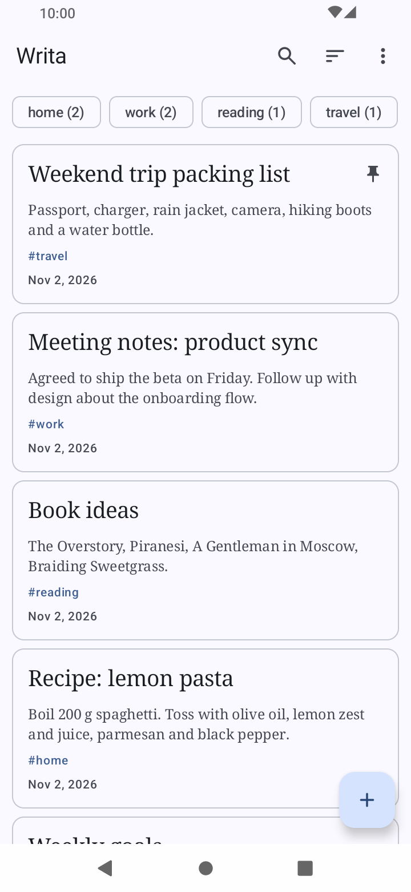
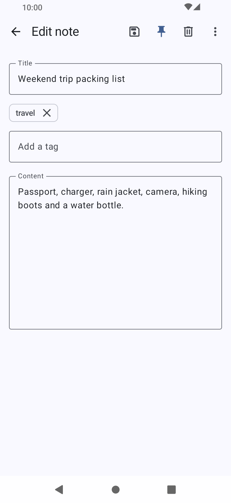
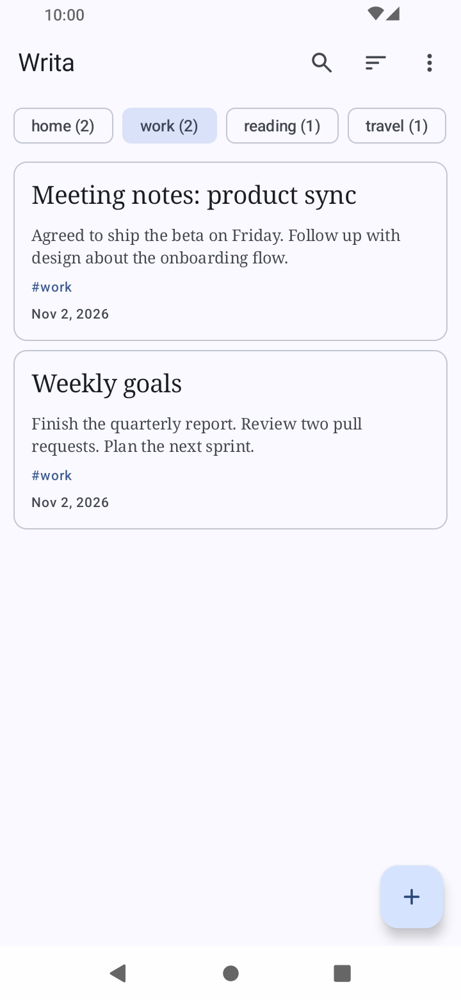
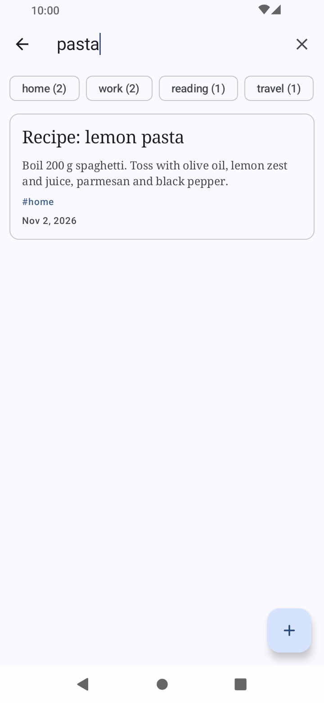
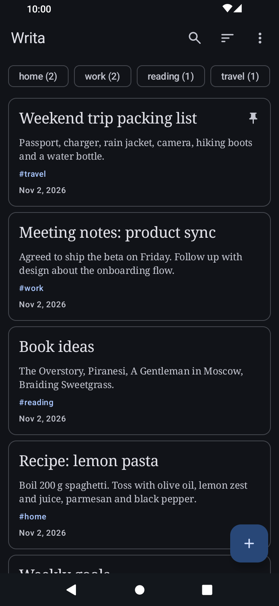
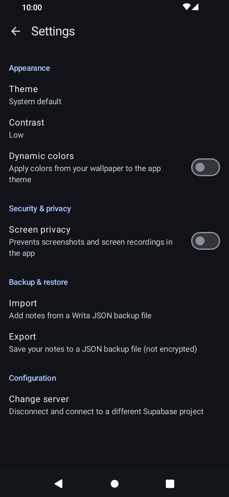

<div align="center">


# Writa

**Your notes. Your server. Your rules.**

Writa is a simple, open-source notes app that connects to your own Supabase backend instead of a company's servers. Whether you're using a free Supabase Cloud project or a self-hosted instance, your notes live where you decide.


</div>

## Features

* **Bring your own backend:** Connect to any Supabase project, Cloud or self-hosted, with your project URL and publishable key. Switch servers anytime from Settings.
* **Private per account:** Each account only sees its own notes, enforced by Row Level Security in your database.
* **Search and sort:** Filter by title or content, and sort by newest, oldest, or title.
* **Tags:** Label notes and filter the list by one or more tags.
* **Archive:** Move notes you want to keep out of the main list, and bring them back any time.
* **Works offline:** Your notes are saved on the device (encrypted), so the list opens instantly. You can read and edit without a connection, and changes upload when you are back online. If the same note was changed elsewhere, your version is kept as a separate "conflict copy" so nothing is lost.
* **Pin and trash:** Pin notes to keep them at the top. Deleted notes go to the trash first, where you can restore them or delete them for good.
* **Backup:** Export your notes to a JSON file and import them back.
* **Themes and privacy:** Light, dark, and dynamic colors, plus an optional screen privacy mode that blocks screenshots.

## Screenshots

<div align="center">
  
  
  
  
  
  
</div>

## Getting Started

You need Android 10 (API 29) or later, and a Supabase project that is reachable over **HTTPS**: either a free [Supabase Cloud](https://supabase.com) project or your own self-hosted instance.

1. Create a project at [supabase.com](https://supabase.com) (or run your own).
2. In the **SQL Editor**, run [`schema.sql`](schema.sql) to create the `notes` table, its Row Level Security policies and the edit-time trigger. The script is safe to run again. If Writa shows an "Update your database" screen, run it again and re-check.
3. Under **Authentication → Sign In / Providers**, enable **Email**. For the easiest setup, turn off **Confirm email**; otherwise new users must confirm by email first, which needs working email delivery.
4. Copy your **Project URL** and **publishable key** from the project's **Connect** dialog (or **Settings → API Keys**). Legacy `anon` keys still work but are being deprecated by Supabase, so prefer the publishable key (`sb_publishable_...`).
5. Open Writa, enter the URL and key on the setup screen, and create an account.

**Only use the publishable (or legacy anon) key.** Never paste a secret or `service_role` key into the app: it bypasses Row Level Security.

To use another server later, go to **Settings → Change server**.

## Verifying a download

Release APKs on GitHub are signed with my key. Verify one with [apksigner](https://developer.android.com/studio/command-line/apksigner.html#options-verify):

```
apksigner verify --print-certs --verbose writa-vX.X.apk
```

It should report `Verifies`, with the certificate `CN=Mowtiie` and this SHA-256 digest. Only install APKs signed with this key:

```
8b6751f3c33185635f989530b6c073a1397b3d412befae6906a2eb5845d2de63
```

Each release also has a detached PGP signature (`.asc`), which confirms that I published that exact file. Import my key and check that the fingerprint matches before trusting it:

```
curl -O https://mowtiie.cc/PGP_PUBLIC_KEY.asc
gpg --import PGP_PUBLIC_KEY.asc
```

```
9EA2 8F46 7802 5092 7643 1B69 42B5 FA42 AA63 90E1
```

Then verify the download:

```
gpg --verify writa-vX.X.apk.asc writa-vX.X.apk
```

## Mapping Files

The mapping file is `app/build/outputs/mapping/release/mapping.txt`, renamed with the version. Release builds are minified with R8, so it is needed to read crash reports: match it to the version under "App Info" in the report and run `retrace` from the Android SDK command-line tools.

## License

This project is licensed under the GNU General Public License v3.0. See the
[LICENSE](LICENSE) file for details.
